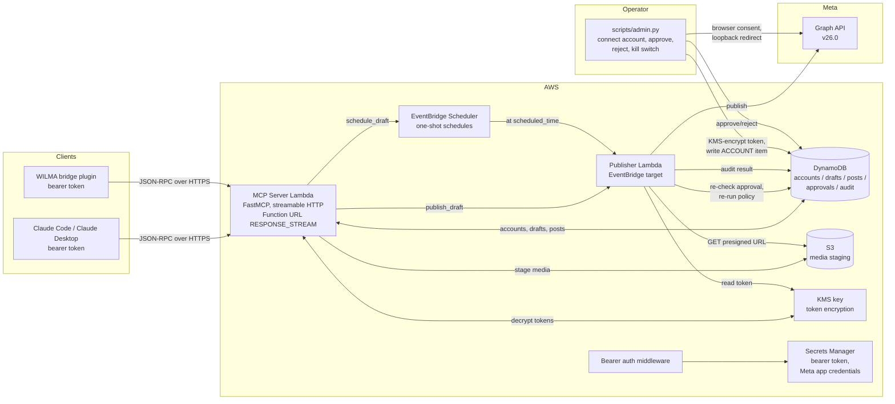
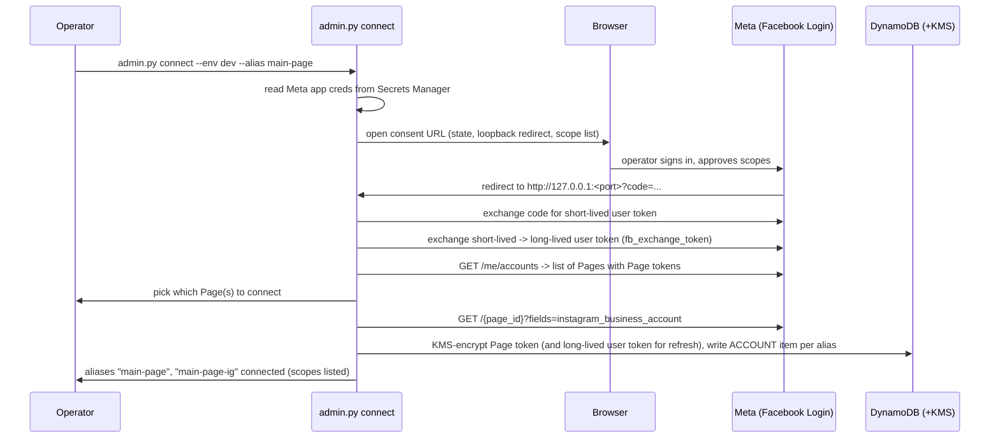

# Social MCP Server: Design Document

A self-hosted MCP server that lets LLM agents (Claude Code, Claude Desktop, WILMA,
and other MCP clients) draft, schedule, publish, and manage social media posts
for pages and accounts the deployment owner controls. One unified tool surface
spans multiple providers so the model never cares which platform an account is
on. Milestone 1 covers Facebook Pages and Instagram professional accounts (both
on Meta's Graph API); the provider interface is designed so X, Bluesky,
Threads, LinkedIn, Mastodon, and a Steam devlog can be added later without
reshaping the tools.

Built on AWS, deployed with CDK, and structured as a portfolio piece. Sibling
project to [slack-mcp](https://github.com/ANamelessDrake/slack-mcp) and
[mail-mcp](https://github.com/ANamelessDrake/mail-mcp); shares their house
conventions, auth model, and public-repo hygiene throughout.

**API versions pinned:** Meta Graph API `v26.0` (released 2026-07-29) for both
Pages and Instagram publishing. Meta docs read 2026-10-11.

## 1. Goals

- Anyone can deploy their own instance against pages and accounts they
  administer; the deployment is the tenancy boundary and each instance is
  operated by its owner.
- Multiple accounts per deployment, mixed-provider (e.g. a Facebook Page and
  an Instagram professional account side by side), each addressed by a short
  alias.
- One tool surface across providers: `draft_post` against a Page and against
  an Instagram account take identical parameters; capability differences
  (video on Facebook vs reels on Instagram, link previews only on Facebook,
  carousels on Instagram) are declared on the provider and the tool refuses
  cleanly when the capability is absent.
- Drafting and publishing are **separate tools, enforced server-side, not
  by the prompt**. Nothing publishes without a human approval recorded in the
  admin CLI, and the approval binds to a hash of the exact text and media; an
  edit after approval voids it.
- Content policy per account, loaded from config at request time (banned
  characters, banned words, required sign-off, hashtag limit, link domain
  allowlist). Policy is config, not code, so brand voice can change without
  a redeploy.
- Provider auth is entirely server-side: a one-time browser consent per owner,
  Page tokens stored KMS-encrypted in DynamoDB, refreshed by the server, never
  visible to any MCP client.
- Works for any MCP client that can send a bearer header, including small
  local models (8B class): few tools, flat parameters, defaults everywhere,
  docstring register matching slack-mcp.
- Infrastructure as code (CDK, Python), least-privilege IAM, unit tests
  (moto), provider tests against recorded Graph API fixtures, CI.

### Non-goals (for now)

- Multi-tenant service with an OAuth 2.1 authorization server. Same decision
  as the siblings (July 2026): single-tenant self-hosting makes the
  deployment the access boundary, and static bearer tokens are its access
  control. Consequence: claude.ai custom connectors (which require OAuth)
  cannot connect; Claude Code, Claude Desktop, and headless clients can.
- Real-time comment ingestion via the Meta Webhook. Pull-based for M1 and
  M2; `list_comments` is on-demand. A webhook-driven inbox is a later phase
  that would reuse the Lambda + DynamoDB plumbing (see section 15).
- Direct message operations on Instagram or Facebook (Messenger). Different
  product surface, different scopes, different review posture; out of scope.
- Instagram Stories as a first-class post kind. Reels and feed posts cover
  the kickoff's "image, carousel and reel posts" scope; Stories can be added
  on the same `STORIES` media container with a capability flag.
- Advertising (boosted posts, promoted content). The server operates on
  organic Page and account content only.
- Posting to Pages or accounts the deployment owner does not administer. See
  section 14 on App Review: the deployment stays in Development Mode with
  Standard Access, and the moment it posts to a third-party Page it needs App
  Review and Business Verification.

## 2. Architecture



### Components

| Component | AWS resource | Responsibility |
|---|---|---|
| MCP server | Lambda (arm64, Python) + Function URL (`RESPONSE_STREAM`) + Lambda Web Adapter | Streamable HTTP MCP endpoint; tool execution; drafts, reads, scheduling; non-publishing provider calls (list, insights) |
| Auth layer | Middleware in the same Lambda | Bearer token validation (constant-time compare against Secrets Manager value) |
| Publisher | Lambda, invoked by EventBridge Scheduler or synchronously by `publish_draft` | The only path that calls Meta's publish endpoints; re-checks the approval hash and re-runs policy immediately before posting |
| Scheduler | EventBridge Scheduler one-shot schedules | Server-side scheduling so the approval re-check runs at publish time (section 7) |
| Media staging | S3 bucket with 24-hour lifecycle | Instagram requires a public URL for every media container; presigned URLs are issued per publish and the bucket cleans itself up |
| Token store | DynamoDB + KMS customer-managed key | Account registry and KMS-encrypted Page / IG tokens; drafts, posts, approvals, audit log |
| Secrets | Secrets Manager | Client bearer token; Meta app id and secret |
| Connect CLI | `scripts/admin.py connect` | One-time authorization code flow per owner, loopback redirect; writes encrypted tokens |
| Admin CLI | `scripts/admin.py` | Approvals, kill switch, account state, audit view |
| IaC | CDK (Python) | Everything above, plus alarms and log retention |

Function URLs are used instead of API Gateway because API Gateway buffers
responses and breaks SSE streaming, which streamable HTTP MCP requires (same
reasoning as the siblings).

The Publisher is a separate Lambda from the MCP server for two reasons.
First, EventBridge Scheduler needs an invocation target that is not behind a
Function URL. Second, isolating the one path that actually posts keeps the
approval re-check and policy re-run on a boundary that is easy to audit: the
MCP server never calls a Meta publish endpoint directly.

### Repository layout

Public repo. Same house conventions as the siblings (Python CDK, `bin/app.py`
entrypoint, per-env config JSON, camelCase stack modules, `deployCDK.sh`
wrapper), same public-portfolio hygiene (docs, tests, CI, examples, no
committed account-specific configuration, no secrets).

```
social-mcp/
  README.md                       # pitch, architecture diagram, quick start
  DESIGN.md                       # this document
  LICENSE                         # MIT
  .gitignore                      # config/{dev,prod}.json, .venv, cdk.out
  .github/
    workflows/
      ci.yml                      # ruff + pytest + cdk synth on push/PR
  pyproject.toml                  # ruff + pytest configuration
  requirements.txt                # CDK app dependencies
  cdk.json                        # {"app": "python3 bin/app.py"}
  deployCDK.sh                    # venv bootstrap, env selection, --auto-approve / --deploy-only
  bin/
    app.py                        # CDK entrypoint; loads config/{env}.json via --context env=<env>
  config/
    example.json                  # committed template: account list, policies, send flags
    README.md                     # what each field means
    (dev.json / prod.json)        # real configs, gitignored
  docs/
    architecture.md               # expanded diagrams and flows
    authentication.md             # bearer model + provider OAuth, rotation, threat notes
    meta-setup.md                 # Meta app + Business runbook (one app, two providers)
    content-policy.md             # per-account policy fields and examples
    images/                       # diagrams, screenshots
  infrastructure/
    stacks/
      secretsStack.py             # bearer token, Meta app credentials
      dynamoDbStack.py            # account/draft/post/audit table + KMS key
      s3Stack.py                  # media staging bucket (24h lifecycle, no public access)
      lambdaFunctionStack.py      # MCP server + publisher functions, Function URL
      schedulerStack.py           # EventBridge Scheduler schedule group + role
      monitoringStack.py          # alarms (error rate, publish anomalies) to alarm_email
      pipelineStack.py            # optional CodePipeline via CodeStar connection
    lambdaFunctions/
      mcpServer/
        app.py                    # FastMCP app behind Lambda Web Adapter
        tools/                    # one module per MCP tool
        auth/                     # bearer token validation middleware
        requirements.txt
      publisher/
        app.py                    # publish worker (approval re-check, policy, Meta POST)
        requirements.txt
      sharedModules/
        models.py                 # Account / Draft / Post / Approval / AuditRow dataclasses
        dynamo.py                 # table access, token read/write, audit append
        crypto.py                 # KMS encrypt/decrypt for provider tokens
        registry.py               # account registry lookups (alias -> provider, state)
        policy.py                 # content-policy engine (config-driven)
        approval.py               # approval hashing + verification
        providers/
          base.py                 # Provider protocol with declared capabilities
          facebook.py             # Facebook Pages via Graph API v26
          instagram.py            # Instagram publishing via Graph API v26
        meta/
          client.py               # Graph API HTTP client (retry, BUC parsing, 190 refresh)
          errors.py               # Meta error -> plain-language mapping
          media_staging.py        # S3 upload + presigned URL + post-publish cleanup
  clients/
    examples/
      claude-code.mcp.json        # .mcp.json snippet for Claude Code
  scripts/
    admin.py                      # connect, list, approve, reject, kill switch, audit
  tests/
    unit/                         # per-module tests (auth, policy, approval, mapping)
    fixtures/
      graph/                      # recorded Graph API responses, scrubbed
    integration/                  # live smoke test against a named Page (off by default)
```

Conventions carried over from the siblings: resources named
`{environment_name}-{project_name}-*` (e.g. `dev-socialmcp-accounts`),
secrets named `{Env}-{Project}-<Name>`, dev and prod environments in
us-east-1 driven entirely by the config JSON, stack wiring done in
`bin/app.py` with cross-stack references passed as constructor arguments,
real `config/{env}.json` gitignored with a committed `example.json`, and CI
running `cdk synth` against `example.json` so infrastructure changes
validate without credentials.

## 3. Provider authentication: one Meta app, one consent per owner

Provider auth and client auth are separate trust boundaries. An MCP client
never sees, and cannot extract, any Meta token; the server never treats
possession of the bearer token as permission to connect new accounts.

### 3.1 Meta app registration (one-time, per deployment)

One Meta Business app covers both providers. The app lives in **Development
Mode**; the operator is an admin on the app and on every Page and Instagram
account the deployment serves. In Development Mode, admins, developers, and
testers can exercise all required scopes against assets they own without App
Review (section 14).

- App type: Business, with the Facebook Login for Business product added and
  the Instagram Platform product added.
- Redirect URI: `http://127.0.0.1:<port>` (loopback) for the connect CLI; a
  Lambda-hosted callback is a later milestone and reuses the same
  token-storage path.
- Credentials (app id, app secret) stored as `{Env}-{Project}-MetaApp` in
  Secrets Manager at deploy time, populated manually by the operator per the
  runbook in `docs/meta-setup.md`.

### 3.2 Scopes

Requested at consent time per owner; recorded on each account item so a tool
call whose required scope the account did not grant fails loudly with an
error message naming the exact scope.

| Capability | Facebook Page scopes | Instagram scopes |
|---|---|---|
| Read-only (M1) | `pages_show_list`, `pages_read_engagement`, `pages_read_user_content`, `read_insights`, `business_management`, `public_profile` | `instagram_basic`, `instagram_manage_insights`, `pages_read_engagement` |
| Publish text / link / photo / multi-photo | `pages_manage_posts` added | `instagram_content_publish` added |
| Publish video / reel | `publish_video` added (FB only) | included in `instagram_content_publish` |
| Comments: list, reply, hide | `pages_manage_engagement` added | `instagram_manage_comments` added |
| Delete post | included in `pages_manage_posts` | `instagram_manage_contents` (added for IG media delete 2025-12-03) |

`business_management` is required by Meta's current app-creation wizard;
`public_profile` is a default basic scope.

### 3.3 The connect flow (CLI, loopback redirect)



The CLI runs on the operator's machine with their AWS credentials; it is the
only component that ever handles an authorization code. A random `state` is
sent to Meta and verified on the redirect. A Lambda-hosted callback (for
operators without local AWS credentials) is a later milestone.

Instagram is reached via the Page it is linked to: the connect flow enumerates
Pages, and for each Page with an `instagram_business_account` id, offers to
create a second account alias of provider `instagram`. The Instagram account
stores the Page token (IG uses the same Page token for its publishing
endpoints) plus the IG user id.

### 3.4 Tokens at run time

- On a tool call, the server loads the account item, KMS-decrypts the token,
  and uses it directly against Graph API. There is no short-lived access
  token exchange step per call: Page tokens derived from a long-lived user
  token do not expire by time (Meta's documented behavior for Page tokens
  minted this way; the server treats a `190` as the trigger to re-mint
  anyway, see below).
- **Token health**: a weekly scheduled Lambda touches `GET /me?fields=id` on
  each stored long-lived user token to keep it alive (user tokens die at 60
  days of inactivity). On any `190 OAuthException` the account is flagged
  `needs_reconnect` and the next tool call surfaces the exact
  `admin.py connect` command rather than retrying.
- **Rotation on `190`**: if a Page call returns `190`, the client refreshes
  the user token via `fb_exchange_token`, re-mints the Page token from
  `/me/accounts`, re-encrypts and persists, and retries the call once.
  Repeated `190` after refresh is a dead grant and sets `needs_reconnect`.
- Tokens are never returned by any tool, written to a log, included in error
  messages, or exported in audit rows. Error paths pass through
  `meta/errors.py` which strips token-shaped substrings as a backstop.

## 4. Client authentication and authorization

### 4.1 MCP client to MCP server

Identical to the siblings: a static bearer token local to the deployment,
generated at deploy time into `{Env}-{Project}-BearerToken`, sent as
`Authorization: Bearer <token>`, compared in constant time by middleware.
Rotation is `put-secret-value` plus a Lambda bounce. Access is all-or-nothing
per token: a holder can draft, approve-via-the-CLI aside, read every
configured account and (if publishing is enabled) publish from them, so the
token is handled like a Meta credential.

### 4.2 Per-connection account scoping

A client that only cares about one account pins its connection with a header,
mirroring mail-mcp's `X-Mail-Mailboxes`:

```
X-Social-Accounts: main-page
```

The middleware validates the names against the roster (a typo 400s at the
door rather than surfacing as "no accounts configured" on every tool call)
and narrows account lookups for the request. This is **scoping, not a
security boundary**: the token still grants the whole deployment and a
client could omit the header. What it buys is that a single-purpose agent
cannot accidentally sweep an unrelated account into its context, and cannot
talk itself into one either, since the header is client configuration the
model cannot alter.

### 4.3 Optional source-IP allowlist

As in mail-mcp, `allowed_client_hostnames` in config lists DNS names
(typically a DDNS record the operator's firewall keeps pointed at their
network) whose currently resolved IPs are the only ones allowed to call the
server. The middleware reads the request's source IP from the Function URL
request context (client-forgeable headers like `X-Forwarded-For` are
ignored), caches DNS for about a minute, and fails closed on resolution
failure.

### 4.4 Inside AWS

Least-privilege IAM: the MCP Lambda may read/write its own table,
`kms:Decrypt` and `kms:Encrypt` with the token key, read its secrets, put
objects into the media bucket with a short-expiry presigned URL, and create
schedules in its own EventBridge schedule group. The Publisher Lambda has
the same key and table access plus `s3:GetObject` on the media bucket and
`dynamodb:UpdateItem` on the audit entries. Nothing in either role touches
IAM, EC2, or any other service. The KMS key policy restricts decrypt to
these two roles and the operator's admin role (for `admin.py connect`). The
Function URL is the only public surface.

## 5. Provider interface: declared capabilities

The core design problem is that posting a photo on Facebook, publishing a
reel on Instagram, and (later) sending a Bluesky skeet are the same verb
from the model's point of view and three different Graph calls underneath.
The server defines a `Provider` protocol with declared capabilities; each
provider module implements the subset it supports; the tool layer refuses
cleanly when a provider lacks a capability.

```python
# providers/base.py (sketch)
class Capability(StrEnum):
    TEXT = "text"
    LINK = "link"
    IMAGE = "image"
    MULTI_IMAGE = "multi_image"
    VIDEO = "video"
    REEL = "reel"
    SCHEDULE = "schedule"
    EDIT = "edit"
    DELETE = "delete"
    COMMENTS = "comments"
    INSIGHTS = "insights"

class Provider(Protocol):
    name: str
    capabilities: frozenset[Capability]
    limits: ProviderLimits   # max text length, max media per post, hashtag cap

    def validate_draft(self, draft: Draft) -> list[Warning]: ...
    def publish(self, draft: Draft, account: Account) -> PublishResult: ...
    def edit(self, post_id: str, patch: PostPatch, account: Account) -> None: ...
    def delete(self, post_id: str, account: Account) -> None: ...
    def list_posts(self, account: Account, since: datetime | None, limit: int) -> list[Post]: ...
    def get_post(self, post_id: str, account: Account) -> Post: ...
    def list_comments(self, post_id: str, account: Account, limit: int) -> list[Comment]: ...
    def reply_to_comment(self, comment_id: str, text: str, account: Account) -> Comment: ...
    def hide_comment(self, comment_id: str, account: Account) -> None: ...
    def get_insights(self, post_id: str, account: Account) -> Insights: ...
```

### Facebook (M1 and M2)

- Capabilities: `TEXT`, `LINK`, `IMAGE`, `MULTI_IMAGE`, `VIDEO`, `REEL`,
  `SCHEDULE`, `EDIT` (same-app-only, see below), `DELETE`, `COMMENTS`,
  `INSIGHTS`.
- Posts:
  - Text / link: `POST /{page_id}/feed` with `message` and / or `link`.
  - Photo: `POST /{page_id}/photos` with `url` or multipart upload.
  - Multi-photo: `POST /{page_id}/photos?published=false` per image to mint
    photo ids, then `POST /{page_id}/feed` with
    `attached_media=[{"media_fbid":"..."},...]`. (Multi-photo field shape
    re-verified at implementation time against the live Pages API docs; the
    posts reference does not spell it out and this is the stable pattern.)
  - Video: `POST /{page_id}/videos` (small files) or the Resumable Upload
    API (large). Needs `publish_video`.
  - Reel: `POST /{page_id}/video_reels` on `rupload.facebook.com`. Also
    needs `publish_video`.
- Edit: `POST /{page_post_id}` with changed fields. **Edits only work on
  posts the same app created.** The provider rejects edits on
  foreign-authored posts with a clear error (not a Meta 200-with-no-change
  which would otherwise look like success).
- Delete: `DELETE /{page_post_id}`.
- Comments: list via `/{post_id}/comments`; top-level reply via
  `POST /{post_id}/comments`; reply-to-reply via
  `POST /{comment_id}/comments`; hide via `POST /{comment_id}` with
  `is_hidden=true`.
- Insights: `GET /{page_post_id}/insights?metric=...`. Only the current
  metric set is exposed (see section 7); deprecated `*_unique` and bare
  `post_impressions*` metrics are not callable.

### Instagram (M1 reads, M2 publish)

- Capabilities: `TEXT` (caption), `IMAGE`, `MULTI_IMAGE` (carousel),
  `VIDEO` (feed video), `REEL`, `SCHEDULE` (server-side only; IG has no
  native scheduled publish), `DELETE`, `COMMENTS`, `INSIGHTS`.
  **No `LINK`** (Instagram does not render URL preview cards from captions)
  and **no `EDIT`** (Meta's IG media endpoints do not support content
  edits).
- Publishing is a two-step container flow:
  1. `POST /{ig_user_id}/media` with `image_url` or `video_url` plus
     caption and type-specific fields; returns a container id.
     - Carousel: create child containers per item with
       `is_carousel_item=true`, then one parent container with
       `media_type=CAROUSEL` and `children=<comma-separated child ids>`
       (up to 10).
     - Reel: `media_type=REELS`.
  2. Poll `GET /{container_id}?fields=status_code` until `FINISHED`
     (typical: image seconds, video tens of seconds). Then
     `POST /{ig_user_id}/media_publish` with `creation_id`.
  - Containers expire 24h unpublished; after that re-create.
- Public URL requirement: Meta fetches `image_url` and `video_url` with
  cURL. Media is staged in S3 under a per-publish prefix, a 15-minute
  presigned URL is passed to Meta, and the object is deleted after the
  container reaches `FINISHED`. The bucket also has a 24-hour lifecycle
  rule as a backstop so unexpected failures do not leave media behind.
- Publishing cap: Meta's docs state 50 or 100 posts / 24h in different
  sections of the same page. Before every publish the provider calls
  `GET /{ig_user_id}/content_publishing_limit` and treats 50 as the safe
  ceiling in the warning layer; a draft that would push the account past
  the cap is rejected at draft time with a specific error (not at publish
  time, where it is too late to help the human).
- Comments: list via `/{ig_media_id}/comments`; reply via
  `POST /{comment_id}/replies`; hide via `POST /{comment_id}` with
  `hide=true`.
- `is_ai_generated` flag (added 2026-06-22) is a `draft_post` option for
  Instagram; set once on the carousel container when it applies.
- `delete_post` on Instagram needs `instagram_manage_contents` (added
  2025-12-03) and is therefore in a separate scope family from publish.

### Adding a provider later

A new provider lands as a module under `providers/` and an entry in the
registry. Documented stub in `providers/stub.py` with the full protocol
annotated. The tool layer requires no change: tools that call
`list_posts`, `publish`, and so on route by alias; a tool whose capability
is missing (`get_insights` on a provider with no insights) returns a
specific error naming the missing capability, not a generic 500.

## 6. Unified data model

Canonical shapes documented so provider mappings are explicit.

| Concept | Facebook | Instagram | Unified |
|---|---|---|---|
| Account | one Page | one IG business/creator account | `account` alias from config |
| Account id | `page_id` | `ig_user_id` | `account_id` |
| Post id | `{page_id}_{post_id}` | `ig_media_id` | `post_id`, provider-native, never parsed |
| Timeline | `/PAGE/feed` and `/PAGE/posts` | `/IG_USER/media` | `list_posts` returns summaries, newest first |
| Draft kind | n/a (Meta has no draft concept) | n/a | server-side `kind` from `TEXT`/`LINK`/`IMAGE`/`MULTI_IMAGE`/`VIDEO`/`REEL` |
| Comments | `/POST/comments`, nested replies | `/MEDIA/comments`, flat with `replies` edge | unified `thread_id` on each comment |

Drafts and approvals are server-side concepts; Meta has neither (a Facebook
"scheduled unpublished" post is Meta's native equivalent of a scheduled
publish, but using it would skip the approval re-check at publish time, so
the server does not use it, see section 7).

### Draft shape

```python
@dataclass
class Draft:
    draft_id: str          # ULID
    account: str           # alias
    kind: str              # text|link|image|multi_image|video|reel
    text: str              # caption or message; empty for image-only reels
    link: str | None       # link posts only; FB only
    media: list[MediaRef]  # list of {source: "s3"|"url", key: str, mime: str}
    schedule: str | None   # ISO 8601; set via schedule_draft
    is_ai_generated: bool  # IG only; informs the Meta flag
    created_at: str
    created_by: str        # the authenticated agent name (from the bearer token's identity)
    status: str            # drafted|awaiting_approval|approved|scheduled|publishing|published|failed|discarded
    policy_warnings: list[str]  # non-blocking policy notes from the last validation
    approval: ApprovalRef | None
    published: PublishResult | None
```

Approvals are described in section 7.

### Post summaries

`list_posts` returns a flat shape designed for small-model context budgets:
`post_id`, `account`, `kind`, `permalink`, `created_time`, `text`
(truncated at a configurable cap, default 300 chars), `media_count`,
`engagement` (likes, comments, shares when provider exposes them). The full
post with insights is a separate `get_post` call.

## 7. Approvals and content policy

Publishing is the only dangerous verb in the system and it is fenced
server-side, not by the prompt.

### 7.1 Separate tools, approval gate on the server

- `draft_post`, `update_draft`, `discard_draft`: do not publish. These
  validate against provider limits and the account's content policy, store
  the draft, and return the `draft_id` with a preview and warnings.
- `publish_draft` and `schedule_draft`: operate **only** on drafts whose
  current content hash matches a recorded approval for that draft, written
  by the operator through `admin.py approve`. There is no "approve" tool
  exposed to MCP clients; a confused or prompt-injected agent cannot
  self-approve.
- Comment replies, comment hides, and post edits/deletes are also gated:
  `reply_to_comment` and `hide_comment` act only on items the operator
  approved (per-comment approval for replies; one-time per-account approval
  for hides, since hiding is reversible from the admin CLI and does not
  reach the network). `edit_post` and `delete_post` require per-post
  approval of the specific change.

### 7.2 Approval hashing

```
hash = sha256(
    canonical_json({
        "account": draft.account,
        "kind": draft.kind,
        "text": draft.text,
        "link": draft.link or "",
        "media": [{"etag": m.etag, "mime": m.mime} for m in draft.media],
        "schedule": draft.schedule or "",
    })
)
```

- Media hashes are **S3 ETags**, so media byte changes void the approval.
- `canonical_json` is sorted-key UTF-8 encoding, so field reordering does
  not change the hash.
- `update_draft` recomputes the hash and silently invalidates the
  approval record. The next `publish_draft` returns a specific error
  naming the drift ("draft was edited after approval; re-run
  `admin.py approve`").

### 7.3 Where the check runs

- `publish_draft` re-checks the hash in the MCP Lambda before invoking the
  Publisher.
- The Publisher re-checks the hash again, immediately before the Meta POST,
  using the same code path. For `schedule_draft`, this second check is the
  important one: a scheduled draft that was edited (and whose approval was
  therefore voided) will fail at the Publisher, in-flight, rather than
  publishing stale approved content.
- Scheduling is **always server-side**, even on Facebook where Meta
  supports `scheduled_publish_time`. Delegating the schedule to Meta would
  skip the re-check and the policy re-run; the kickoff's binding
  "approval = exact text and media hash" has to survive the schedule-to-
  publish gap.

### 7.4 Optional per-account auto-publish

Config may enable `auto_publish_kinds: ["text"]` on a specific account for
low-risk kinds (text-only brand updates, for example). When enabled, the
server treats `draft_post(kind="text", auto_publish=true)` as if the draft
had just been approved: the hash is recorded as an implicit approval and
the publish proceeds. Off by default on every account. Auto-publish never
covers scheduled posts, comments, edits, or deletes.

### 7.5 Content policy (config, not code)

```json
{
  "accounts": {
    "main-page": {
      "policy": {
        "banned_characters": ["\u2014"],
        "banned_words": ["Claude", "Anthropic"],
        "required_signoff": "",
        "max_hashtags": 5,
        "allowed_link_domains": ["justbardtech.com"],
        "voice": "brand or WILMA"
      }
    }
  }
}
```

- `banned_characters`: a list of forbidden Unicode code points. For my
  own accounts, this is `U+2014` (em dash); the global rule is "no em
  dash anywhere" and the policy enforces it per account.
- `banned_words`: substring matches, case-insensitive. For my accounts,
  "Claude" and "Anthropic" are forbidden (the AI name publicly is WILMA,
  per the global rule).
- `required_signoff`: an optional literal that must appear at the end of
  the text (empty string = no requirement).
- `max_hashtags`: integer cap; `-1` for no cap.
- `allowed_link_domains`: a non-empty list restricts link posts to those
  domains; omitted or empty permits any domain.
- `voice`: documentation-only field surfaced in the preview so the
  operator sees the intended register.

Policy violations block `draft_post` with a specific error per field (not a
generic "policy violation"), so the model can self-correct. Policy also
runs again in the Publisher so a config change between approval and
publish is honored.

### 7.6 Global and per-account kill switches

- `publishing_enabled: false` globally in config disables every publish
  path (also toggleable at runtime by `admin.py disable-publishing`).
- `accounts.<alias>.publish_enabled: false` disables publish on one
  account.
- Both are checked in the Publisher, after the approval re-check, before
  the Meta call. A disabled account fails every `publish_draft` and
  `schedule_draft` call loudly.

## 8. MCP tool surface

Designed to the weakest caller (8B local models): few tools, flat
parameters, strings and integers only, defaults for everything optional,
imperative descriptions. Media lists are comma-separated strings (same
pattern slack-mcp uses for `channel`).

| Tool | Parameters | Notes |
|---|---|---|
| `list_accounts` | none | Alias, provider, display name, capabilities, publish_enabled, token health, scopes granted, expiry hint |
| `draft_post` | `account?`, `kind`, `text?`, `link?`, `media?`, `is_ai_generated?`, `scheduled_time?`, `auto_publish?` | Validates against provider limits and account policy; stores the draft; returns `draft_id`, provider name, preview, warnings. Never publishes. `media` is a comma-separated list of S3 keys (from `stage_media`) or https URLs. `account` can be omitted when only one is configured |
| `get_draft` | `draft_id` | Full draft including approval status and current hash |
| `list_drafts` | `account?`, `status?`, `limit?` | Drafts newest first; `status` filters to `awaiting_approval`, `approved`, `scheduled`, `failed` |
| `update_draft` | `draft_id`, `text?`, `link?`, `media?`, `scheduled_time?` | Edits a draft and silently voids any existing approval |
| `discard_draft` | `draft_id` | Soft-delete; audit-logged |
| `stage_media` | `data_base64`, `mime_type`, `filename?` | Uploads bytes to the media bucket, returns an `s3://` key usable in `draft_post` and `update_draft`. Short-lived (24h lifecycle) |
| `publish_draft` | `draft_id` | Re-checks approval hash and policy; invokes the Publisher synchronously; returns the provider post id and permalink. Gated by `publishing_enabled` and per-account `publish_enabled` |
| `schedule_draft` | `draft_id`, `scheduled_time` | Creates an EventBridge one-shot schedule for the Publisher; same gates. For Facebook, 10 minutes to 30 days ahead; for Instagram, any future time (server-side) |
| `list_posts` | `account?`, `since_days?`, `limit?` | Post summaries newest first; empty `account` sweeps every configured account (mail-mcp fan-out semantics; partial-failure tolerant) |
| `get_post` | `post_id`, `account?` | Full post plus insights |
| `edit_post` | `post_id`, `text?`, `account?` | Facebook only; requires per-post approval; errors on IG with a specific "edit not supported on instagram" message |
| `delete_post` | `post_id`, `account?` | Requires per-post approval; moves to Facebook's trash view or deletes IG media; audit-logged |
| `list_comments` | `post_id`, `account?`, `limit?` | Flattens nested replies with `thread_id` |
| `reply_to_comment` | `comment_id`, `text`, `account?` | Requires per-comment approval; audit-logged |
| `hide_comment` | `comment_id`, `account?` | Requires per-account hide approval (reversible from admin CLI) |
| `get_insights` | `post_id`, `account?` | Post-level metrics mapped to the unified set, see below |

### Unified insights

The server returns a small, provider-agnostic shape (`impressions`,
`reach`, `engagements`, `reactions`, `comments`, `shares` on FB; `impressions`
replaced by `reach` + `views` on IG) built from the current non-deprecated
metrics per provider. Meta's deprecation wave at 2026-06-15 removes the
old `*_unique` and bare `post_impressions*` metrics; the server never
requests those. The provider module records the exact Graph metric name
it mapped each unified field from, surfaced in `get_insights` under
`source_metrics` so the mapping is auditable.

### What is deliberately omitted

- **No `approve` tool**: the operator approves via `admin.py` only.
- **No raw-Graph escape hatch**: unlike mail-mcp's `raw_query`, this tool
  surface is write-sensitive and a provider-native escape hatch would
  move the gates to the model's integrity. If a specific capability is
  missing it is added as a tool, not a passthrough.
- **No comment deletion**: hiding is sufficient and reversible; deletion
  is destructive and asymmetric with Meta's own UI (hidden comments can
  be shown again; deleted comments cannot).

## 9. Media staging

Instagram's requirement that `image_url` and `video_url` be publicly
reachable is handled by a per-publish S3 workflow:

1. `stage_media` (or a direct `draft_post` with a given https URL) places
   the bytes in `s3://<media-bucket>/staging/<account>/<ulid>/<name>`.
   The bucket blocks all public access and has a 24-hour lifecycle rule.
2. At publish time the Publisher issues a presigned GET URL with a
   15-minute expiry and passes it as `image_url` or `video_url` to Meta.
3. For images, Meta fetches synchronously, so the Publisher waits for the
   container to reach `FINISHED` (expected within seconds), publishes,
   then deletes the staged object.
4. For video and reels, container creation returns before Meta's fetch
   finishes; the Publisher polls `status_code` on an exponential backoff
   (1s, 2s, 4s, 8s, ..., capped at 60s between polls, capped at 10
   minutes total). When `FINISHED` it publishes and deletes the staged
   object. On `ERROR` or `EXPIRED` it audits the failure and leaves the
   lifecycle rule to clean up.

The 15-minute presign is deliberately short so a leaked URL does not stay
useful; Meta's fetch happens in seconds, so a 15-minute window is 50x
headroom. Facebook photo and video posts also go through the same staging
path for consistency, even though Facebook accepts multipart uploads; it
means the Publisher has one media code path.

## 10. DynamoDB schema

One table, `{env}-socialmcp-core`, on-demand capacity, four item families
distinguished by `PK` prefix. All items carry `created_at` (ISO 8601) for
operational visibility.

### `ACCOUNT#<alias>`

| Attribute | Example | Notes |
|---|---|---|
| `PK` | `ACCOUNT#main-page` | Alias from config |
| `provider` | `facebook` / `instagram` | Selects the provider module |
| `account_id` | `page_id` or `ig_user_id` | Provider-native id |
| `display_name` | `JustBard Technologies` | For human-facing output |
| `scopes` | `["pages_manage_posts", ...]` | Gates write/publish tools |
| `page_token_ct` | (binary) | KMS ciphertext, never logged |
| `user_token_ct` | (binary) | Only on the primary account per owner, for refresh |
| `token_minted_at` | ISO 8601 | When the Page token was last refreshed |
| `status` | `active` / `needs_reconnect` | Set on grant failure |
| `publish_enabled` | boolean | Mirrors config; set at deploy |
| `linked_ig_account` | alias | For Pages that have an IG account; back-ref |
| `linked_page` | alias | For IG accounts; forward-ref to Page |

### `DRAFT#<draft_id>`

Full draft dataclass (section 6). `GSI1PK = DRAFTS#<account>` and
`GSI1SK = CREATED#<timestamp>#<status>` for `list_drafts`.

### `APPROVAL#<draft_id>`

| Attribute | Notes |
|---|---|
| `PK` | `APPROVAL#<draft_id>` |
| `content_hash` | sha256 of the canonical draft (section 7.2) |
| `approved_by` | operator identity (OS user from the admin CLI) |
| `approved_at` | ISO 8601 |
| `scope` | `publish` / `schedule` / `edit:<post_id>` / `reply:<comment_id>` / `hide:<account>` |

### `AUDIT#<account>` with `SK = TS#<iso8601>`

Append-only. Columns: `kind` (`draft`, `approve`, `reject`, `publish`,
`schedule`, `edit`, `delete`, `reply`, `hide`), `actor_identity` (from
the bearer token's agent name on tool paths; the operator's OS user on
admin CLI paths), `draft_id` / `post_id` / `comment_id` as applicable,
`result` (`ok`, `error:<meta_code>`), `request_ms`. **No tokens, no raw
message bodies in audit** (the draft itself holds those); the audit row
holds a reference, not a copy, so a GDPR-shaped delete of a draft also
sanitizes the trail.

## 11. Rate limits and error handling

### 11.1 Shared Graph client

A single `meta/client.py` wraps all Graph calls with:

- **Backoff on 4, 17, 32, 613 (subcode 1996), and BUC codes 80001 (Pages)
  / 80002 (IG)**: exponential retry (1s, 2s, 4s, 8s, 16s) up to 5
  attempts, with jitter. `estimated_time_to_regain_access` from the
  `X-Business-Use-Case-Usage` header overrides the backoff when present.
- **190 (token expired/invalid)**: not retried blindly. Routes through
  the token refresh path (section 3.4); on success the call retries
  exactly once; on failure the account is flagged `needs_reconnect`.
- **100 (bad parameter) and other 4xx bodies**: not retried; the error is
  mapped to a plain-language message that names the field that was wrong.

### 11.2 Error mapping

`meta/errors.py` turns Meta error codes into messages a human (or an 8B
model) can understand. Examples: code 100 subcode 2018001 ("owning page
id mismatch") becomes "the Page token does not belong to this Page; the
account needs reconnecting". Code 10 ("permission denied") becomes "this
account did not grant the <scope> scope at consent time; re-run
`admin.py connect` with the <capability> capability".

### 11.3 IG publishing budget

As noted in section 5, every IG publish is preceded by a call to
`/{ig_user_id}/content_publishing_limit`. The number is cached per account
in memory for 60 seconds (so a batch publish does not hit the limit
endpoint on each call). When the cached count is at or above the 50-safe
threshold, `draft_post(kind=<any IG kind>)` warns, and `publish_draft`
refuses with a specific error naming the remaining capacity and the
reset time.

### 11.4 Facebook rate posture

Pages API: 4800 x Engaged Users / 24h via BUC 80001. For a small
deployment this ceiling is not reachable at normal cadence; the backoff
path above handles the occasional spike. The MCP server surfaces the
app-usage headers in CloudWatch metrics (`app_usage_call_count`,
`app_usage_total_time`) so an operator can see when they are approaching
the ceiling without parsing logs.

## 12. Testing

Three layers, matching the siblings:

1. **Unit tests, offline**: moto for DynamoDB, S3, Secrets Manager, KMS.
   Full coverage of policy, approval hashing, provider dispatch, tool
   parameter validation. Mutation-check the approval gate (remove it in
   the test harness and confirm every publish test fails).
2. **Provider tests against recorded fixtures**: `tests/fixtures/graph/`
   holds JSON responses captured from a real test Page in Development
   Mode, scrubbed of tokens and ids with a committed scrub script.
   Provider modules call a swapped `GraphClient` that returns these
   fixtures by (method, path, params). Fixtures shaped like real
   responses prevent the "test double built to match my code's beliefs"
   antipattern.
3. **Live smoke test, off by default**: `tests/integration/` posts a
   dated text post to a named test Page, polls the insights endpoint,
   and deletes the post. Gated by `SOCIAL_MCP_LIVE_PAGE_ID` env var; CI
   does not run it; the operator triggers it when a release is about to
   ship.

## 13. Threat notes

Three untrusted inputs flow through the server; each has an explicit
mitigation.

- **MCP-client-authored draft text**: untrusted to the extent that a
  prompt-injected agent might try to publish adversarial content. The
  approval gate (section 7) is the primary defense; the policy engine is
  secondary (banned words, link domain allowlist, hashtag cap); the
  per-account `publish_enabled` kill switch is the backstop.
- **Comment text from the public**: untrusted LLM input. `list_comments`
  returns content as data; the server never executes anything from a
  comment, never auto-fetches a URL it carries, and comment replies
  reach the Meta API only via the per-comment approval path. A
  prompt-injected reply draft cannot be sent without that approval, same
  as any other publish verb.
- **Media files**: a client could stage a malicious image or video.
  Mitigations: `stage_media` writes to an S3 prefix with no server-side
  execution, no public access, 24-hour lifecycle; media is served to
  Meta via a short-lived presigned URL and deleted after publish; the
  server does not execute, render, or parse media content beyond basic
  MIME validation.

Other notes:

- Meta app secret stored in Secrets Manager, read only at cold start,
  never passed through tool output or audit.
- Tokens never returned by any tool, never written to logs. Error paths
  go through `meta/errors.py` which strips token-shaped substrings as a
  backstop.
- The AppSync-events / webhook ingest path from slack-mcp is deliberately
  not present: the server never accepts an inbound webhook from Meta in
  M1 or M2, so there is no public ingest endpoint and no signing-secret
  verification code path to review. When webhooks are added later, they
  land on their own Function URL with their own signing path, mirroring
  slack-mcp's ingest Lambda.
- `scripts/admin.py` runs with the operator's AWS credentials; the KMS
  key policy restricts decrypt to the two Lambda roles and the
  operator's admin role; the Function URL is the only public surface.

## 14. App Review and Business Verification posture

- The Meta app stays in **Development Mode**. In Development Mode, app
  admins, developers, and testers can call every scope in section 3.2
  against assets they own, without App Review.
- The deployment serves only Pages and Instagram accounts the operator
  administers. Standard Access is sufficient.
- **Business Verification is not required** for this posture. The
  moment the deployment is used to post to a Page or IG account the
  operator does not own, Business Verification plus App Review for every
  listed scope become mandatory. That transition is intentionally out of
  scope for this project.
- The `docs/meta-setup.md` runbook spells out exactly how to add the
  operator as an admin on the app and as a Page admin on each managed
  Page so Development Mode covers the whole surface. If the operator
  loses a Page admin role, the connect flow re-fails on that Page's
  scopes and the account is flagged `needs_reconnect`.
- Note on self-admin wording: Meta's current public documentation
  confirms App Review as a submission flow, not an unconditional
  requirement, but the "self-admin stays on Standard Access" reading is
  not quoted verbatim on the pages read. The runbook will link Meta's
  own App Review page for the operator to verify on the day they
  deploy, and the design does not depend on that reading surviving
  verbatim: either way, the fallback is to submit the scopes for
  Advanced Access, which is a configuration step, not a design change.

## 15. Milestones

Each milestone is independently demoable. The ordering frontloads the
most-used read verbs so there is a visible slice before the publish
mechanics land.

1. **Read-only Facebook Pages (M1)**: CDK stacks (secrets, table + KMS,
   Lambda + Function URL, monitoring), FastMCP server with bearer auth,
   `admin.py connect` flow, provider interface with Facebook read ops,
   tools `list_accounts`, `list_posts`, `get_post`, `list_comments`,
   `get_insights`. Scopes: `pages_show_list`, `pages_read_engagement`,
   `pages_read_user_content`, `read_insights`, `business_management`,
   `public_profile`. Demo: Claude Code summarizes recent posts and
   insights for a real Page.
2. **Facebook publishing + approval gate + policy engine**: `draft_post`,
   `publish_draft`, `schedule_draft` (server-side scheduler), the
   approval hashing and per-account policy, `admin.py` approve/reject
   subcommands, mutation-checked approval tests, audit rows. Scopes add
   `pages_manage_posts`, `publish_video`. Demo: human drafts a text
   post, operator approves in the CLI, scheduled publish fires.
3. **Facebook comments + edit + delete**: `list_comments`,
   `reply_to_comment`, `hide_comment`, `edit_post`, `delete_post`,
   per-comment and per-post approval scopes. Scopes add
   `pages_manage_engagement`. Demo: agent sees a comment, drafts a
   reply, operator approves, reply posts.
4. **Read-only Instagram**: Instagram provider with the read half of the
   protocol, S3 media bucket in place, IG scope set applied at connect
   time. Tools reuse. Demo: `get_insights` returns IG metrics against
   a connected IG account.
5. **Instagram publishing (image, carousel, reel)**: Publisher S3 media
   staging path, container flow, `content_publishing_limit` precheck,
   `is_ai_generated` optional flag, Instagram comments. Scopes add
   `instagram_content_publish`, `instagram_manage_comments`,
   `instagram_manage_contents` (for delete). Demo: full image +
   carousel + reel publish from a Claude Code conversation, approved
   from the CLI.
6. **Hosted OAuth callback (optional)**: small Lambda + Function URL
   implementing the redirect target so accounts can be connected
   without local AWS credentials; reuses the token-storage path.
7. **Comment webhooks (optional)**: Meta Webhook subscription Lambda
   that mirrors slack-mcp's ingest for real-time comment events; adds a
   `wait_for_comments` long-poll on the back of AppSync Events. Opens
   the "agent sees comments arrive and drafts replies live" pattern.
8. **A third provider**: Bluesky (atproto has no App Review posture and
   publishing-only scope is trivial), as the pressure test for the
   provider interface.

Milestones 1 through 5 cover the kickoff. 6 through 8 are optional
follow-ons.

## 16. Cost estimate (personal scale)

| Item | Estimate |
|---|---|
| Lambda (arm64, request-scoped) | < $1/mo |
| DynamoDB on-demand | < $1/mo |
| KMS customer-managed key | $1/mo (+ negligible request cost) |
| S3 media staging (24h lifecycle) | < $0.10/mo at normal cadence |
| EventBridge Scheduler | free at this scale |
| Secrets Manager | $0.80/mo (2 secrets) |
| CloudWatch logs (retention capped) | < $1/mo |
| Meta Graph API | free |
| **Total** | **~ $3 to 5/mo** |

## 17. Security summary

- **Deployment account choice**: deploy into a **personal AWS account**,
  never a corporate or otherwise shared one. The design's privacy model
  is that the account boundary and the tenancy boundary coincide; every
  admin in the AWS account can reach the KMS key that protects the
  provider tokens. Same guidance as mail-mcp.
- **Trust boundaries**: static bearer token for MCP clients (Secrets
  Manager, constant-time compare, rotate by overwrite + bounce);
  per-account Meta tokens (KMS-encrypted at rest, decrypted only inside
  the Lambdas, rotated on `190`, revocation surfaces as
  `needs_reconnect`).
- **Server-side scheduling only** (no delegation to Meta's native
  scheduled posts) so the approval re-check and policy re-run run at
  publish time, not at approval time.
- **Separate Publisher Lambda** so the only path that calls Meta's
  publish endpoints has a dedicated role, a dedicated review surface,
  and no exposure to MCP client traffic.
- **No token ever leaves the server side**; no tool returns a token,
  logs one, or includes one in an error. Error paths pass through a
  redactor as a backstop.
- **Content policy per account, from config**: banned characters, banned
  words, required sign-off, hashtag cap, link domain allowlist. Policy
  runs at draft time and again at publish time.
- **Four-way publish fence**: provider scope presence, global
  `publishing_enabled`, per-account `publish_enabled`, per-item approval
  hash match.
- **Everything auditable**: `AUDIT#` items for every draft, approval,
  publish, edit, delete, reply, and hide.
- **Function URL is the only public surface**; optional source-IP
  allowlist (DDNS-tracked hostnames) rejects requests from outside the
  operator's network before token comparison.

## 18. Open questions

- **Multi-photo field shape on Facebook**: the `attached_media` pattern
  is the stable one but Meta's current Pages API posts reference does
  not spell it out verbatim. Re-verify against the live docs when M2 is
  implemented; the design does not change either way.
- **IG publishing cap number**: Meta's docs give both 50/24h and 100/24h
  on the same page. The design uses the live `content_publishing_limit`
  endpoint; the fallback ceiling in warnings is 50. Re-confirm against
  a connected account during M5.
- **Page token non-expiry**: this is the long-standing Meta behavior for
  Page tokens minted from long-lived user tokens but Meta's current
  Access Tokens page does not state it verbatim. The design does not
  depend on it (we handle `190` either way); worth re-verifying in M1
  so the runbook is accurate.
- **`pages_read_user_content` vs `pages_read_user_engagement`**: Meta's
  own pages use different names in different places. Re-verify at M1
  deploy time; whichever name Meta's wizard requires at that moment is
  what the runbook asks for.
- **Vision-capable comment replies**: a later agent might want to see
  the image attached to a post before replying to a comment on it. The
  current `list_comments` and `get_post` surface returns URLs, not MCP
  image blocks; that is the natural next-step shape when the surface
  grows a second return type.
- **Secretary-style loop**: the mail-mcp secretary agent pattern
  (section 9 of its DESIGN.md) composes mail-mcp with slack-mcp into a
  draft-and-approve loop. The same pattern applies here: an operator
  gets a Slack DM with the draft, replies "yes", and the publish fires.
  Worth prototyping as a client in `clients/` after M5.
