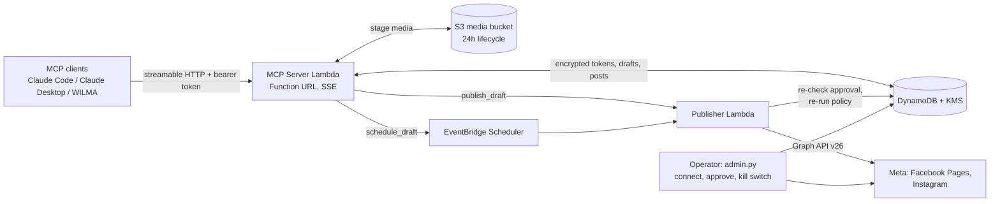

# social-mcp

One MCP server for your social media accounts, so your LLM agents can draft,
schedule, publish, and manage posts across the platforms you own without
caring which platform a given account is on.

Point any MCP client that supports HTTP transport with a bearer token, such
as Claude Code, Claude Desktop, or a homegrown agent, at your deployment and
ask it to work on your Pages and accounts: "draft a text post about the new
feature", "list unread comments on the latest post", "insights for last
week's reel". Drafting is always separate from publishing; the server
enforces a human approval (recorded in the admin CLI) before anything
reaches a provider, and the approval binds to the exact text and media, so
an edit after approval voids it.

You deploy your own instance into your own (personal) AWS account. There is
no shared service and no third party in the publishing path: provider
tokens are KMS-encrypted in your DynamoDB table, and no social-platform
credential is ever visible to an MCP client. Sibling project to
[slack-mcp](https://github.com/ANamelessDrake/slack-mcp) and
[mail-mcp](https://github.com/ANamelessDrake/mail-mcp), sharing their
conventions and auth model.

**Status**: design phase. See [DESIGN.md](DESIGN.md) for the full plan;
code lands milestone by milestone (see roadmap below).

## What it does (planned)

- **One tool surface, multiple providers**: `draft_post` against a Facebook
  Page and against an Instagram account take the same parameters; the server
  maps to each provider's Graph API endpoints and declares per-provider
  capabilities so a tool fails cleanly when the platform does not support
  something (link posts on Instagram, edits on Instagram media, and so on).
- **Multiple accounts per deployment**, mixed-provider, each addressed by
  a short alias (`main-page`, `main-page-ig`).
- **Server-side provider OAuth**: a one-time browser consent per owner
  (`scripts/admin.py connect`); Page and Instagram tokens are KMS-encrypted
  at rest and never leave the server side.
- **Approval gate enforced by the server, not the prompt**: `draft_post`
  stores drafts and returns a preview; `publish_draft` and `schedule_draft`
  act only on drafts whose current content hash matches an approval
  record. Any edit after approval voids it (the approval binds to a hash
  of the exact text and media).
- **Per-account publish mode**: each account picks one of `manual`
  (every post needs `admin.py approve` first; default; use on
  public-facing accounts), `auto` (the server records the approval
  implicitly, so an agent can draft and publish in one shot; use on
  dev / sandbox / internal pages), or `auto_for` with a kinds list
  (auto-approve text, hold media for review). Policy, hashing, and
  audit log work the same way in every mode; auto mode skips the
  human review, not the content integrity check. Edits, deletes, and
  comment replies always need operator approval regardless of mode.
- **Content policy per account, from config**: banned characters, banned
  words, required sign-off, hashtag limit, link domain allowlist. Enforced
  at draft time and again at publish time; brand voice changes without a
  redeploy.
- **Server-side scheduling** via EventBridge Scheduler, even on Facebook
  where Meta supports native scheduled posts, so the approval re-check and
  policy re-run always run at publish time.
- **Media staging for Instagram**: media lands in a 24-hour S3 bucket;
  Meta fetches it via a short-lived presigned URL; the server cleans up
  after `FINISHED`.
- **Audit log for everything**: drafts, approvals, publishes, edits,
  deletes, replies, and hides are append-only in DynamoDB.
- **Small-model friendly**: few tools, flat string/int parameters, defaults
  everywhere, so 8B local models can drive it, not just frontier models.

## Architecture



Serverless throughout: two Lambdas (MCP server + Publisher), one DynamoDB
table, one KMS key, one small S3 bucket, a handful of secrets. The split is
deliberate: the Publisher is the only path that calls Meta's publish
endpoints, which keeps the approval re-check and policy re-run on a boundary
that is easy to audit, and gives EventBridge Scheduler an invocation target
that is not behind a Function URL. Full rationale, data model, and threat
notes in [DESIGN.md](DESIGN.md).

## Authentication model

Two separate trust boundaries (DESIGN.md sections 3 and 4):

- **Client to server**: a static bearer token generated at deploy time and
  held in Secrets Manager; whoever has it can draft against every
  configured account and (if publishing is enabled) publish from them, so
  share it like a social-platform password. Rotate by overwriting the
  secret and bouncing the Lambda. Optionally, `allowed_client_hostnames`
  locks the endpoint to your own network via a DDNS record enforced ahead
  of the token check.
- **Per-connection account scoping**: a client can pin itself to a subset
  of accounts with an `X-Social-Accounts: main-page` header, so a
  single-purpose agent only ever sees that account (scoping for focus,
  not a security boundary; see DESIGN.md section 4.2).
- **Server to Meta**: per-owner OAuth tokens (long-lived user token for
  refresh, plus Page tokens for Facebook and the shared Page token for
  Instagram), all KMS-encrypted in DynamoDB, obtained by a one-time local
  consent flow (loopback redirect). No Meta credential is ever visible to
  an MCP client, in a log, or in this repo.

A multi-tenant OAuth 2.1 mode is deliberately out of scope, same trade-off
as the siblings: claude.ai custom connectors (which require OAuth) cannot
connect.

## Tool surface (planned)

| Tool | Parameters | What it does |
|---|---|---|
| `list_accounts` | none | Alias, provider, display name, capabilities, publish_enabled, token health, granted scopes |
| `draft_post` | `account?`, `kind`, `text?`, `link?`, `media?`, `is_ai_generated?`, `scheduled_time?`, `auto_publish?` | Validates against provider limits and account policy; stores the draft; returns `draft_id`, preview, warnings. Never publishes |
| `get_draft` / `list_drafts` / `update_draft` / `discard_draft` | | Draft lifecycle; `update_draft` silently voids any existing approval |
| `stage_media` | `data_base64`, `mime_type`, `filename?` | Uploads bytes to the media bucket, returns an `s3://` key usable in `draft_post` |
| `publish_draft` | `draft_id` | Re-checks approval and policy; invokes the Publisher synchronously |
| `schedule_draft` | `draft_id`, `scheduled_time` | Creates a one-shot EventBridge schedule for the Publisher; same gates |
| `list_posts` | `account?`, `since_days?`, `limit?` | Empty `account` sweeps every configured account (fan-out, partial-failure tolerant) |
| `get_post` | `post_id`, `account?` | Full post plus insights |
| `edit_post` | `post_id`, `text?`, `account?` | Facebook only; requires per-post approval |
| `delete_post` | `post_id`, `account?` | Requires per-post approval; audit-logged |
| `list_comments` | `post_id`, `account?`, `limit?` | Flattens nested replies |
| `reply_to_comment` | `comment_id`, `text`, `account?` | Requires per-comment approval |
| `hide_comment` | `comment_id`, `account?` | Reversible; requires per-account hide approval |
| `get_insights` | `post_id`, `account?` | Unified metrics mapped to each provider's current (non-deprecated) set |

Approval and the per-account content policy are documented in
DESIGN.md section 7. The admin CLI (`scripts/admin.py`) carries the
approve, reject, kill-switch, and audit-view subcommands; MCP clients
have no `approve` tool.

## Providers

- **Facebook Pages** via Meta Graph API v26.0: text, link, photo,
  multi-photo, video, and reel posts; server-side scheduling; edit (same
  app only) and delete; comments (list, reply, hide); insights.
- **Instagram professional accounts** via the same Graph API: image,
  carousel, and reel publishing through media containers; comments;
  insights. No link posts; no content edits; publishing cap enforced via
  `content_publishing_limit`.

Both ride a single Meta app in Development Mode. The design does not
require App Review or Business Verification for the self-admin case; see
DESIGN.md section 14 for the exact posture and the one condition under
which that stops being true.

The provider interface declares capabilities (text, link, image, multi,
video, reel, schedule, edit, delete, comments, insights) and a
`providers/stub.py` is the documented starting point for adding X,
Bluesky, Threads, LinkedIn, Mastodon, or a Steam devlog later.

## Roadmap

| Milestone | Scope | Status |
|---|---|---|
| 1. Read-only Facebook Pages | CDK stacks, MCP server, `admin.py connect`, read tools (`list_accounts`, `list_posts`, `get_post`, `list_comments`, `get_insights`) | Planned |
| 2. Facebook publishing + approval gate + policy engine | `draft_post`, `publish_draft`, `schedule_draft`, approval hashing, per-account policy, admin CLI approve/reject | Planned |
| 3. Facebook comments + edit + delete | `reply_to_comment`, `hide_comment`, `edit_post`, `delete_post`, per-item approval scopes | Planned |
| 4. Read-only Instagram | Instagram provider's read half, S3 media bucket | Planned |
| 5. Instagram publishing | Container flow (image, carousel, reel), publishing-limit precheck, `is_ai_generated` | Planned |
| 6. Hosted OAuth callback | Account connect without local AWS credentials | Optional |
| 7. Comment webhooks | Real-time comment ingest via Meta Webhook, `wait_for_comments` long-poll | Optional |
| 8. A third provider | Bluesky, pressure-testing the provider interface | Optional |

## Local development (once scaffolding lands)

```bash
python3 -m venv .venv && source .venv/bin/activate
pip install -r requirements.txt -r requirements-dev.txt

ruff check .
pytest    # unit tests run fully offline (moto)
```

## Repository layout (planned)

```
bin/, config/, infrastructure/   CDK app: entrypoint, per-env config, stacks, Lambda code
docs/                            Meta app setup runbook, content-policy guide, architecture
clients/examples/                Example MCP client configs
scripts/                         admin.py (connect, approve, kill switch, audit)
tests/unit/                      Offline unit tests
tests/fixtures/graph/            Recorded Graph API responses, scrubbed
tests/integration/               Live smoke test against a named test Page (off by default)
```

## License

MIT. See [LICENSE](LICENSE).
