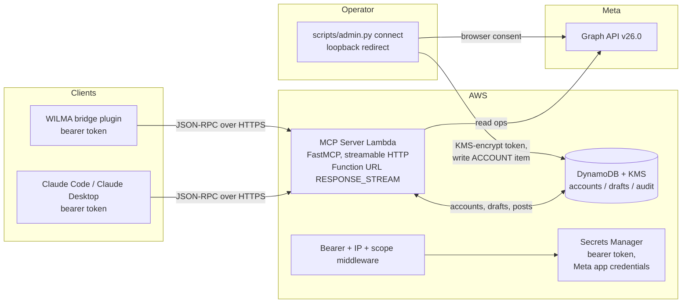

# Architecture

See [DESIGN.md](../DESIGN.md) for the full design rationale, data model,
and threat notes; this file is a shorter architectural overview for anyone
scanning the repo.

## Shape

M1 is read-only: one Lambda, one table, one KMS key, two Secrets Manager
entries. The Publisher Lambda, EventBridge Scheduler, and S3 media bucket
land with M2 and M5; see [DESIGN.md section 2](../DESIGN.md) for the full
architecture.

## Request path

1. **IP allowlist** (`auth/ipgate.py`): if `ALLOWED_CLIENT_HOSTNAMES` is
   set, the request's Function-URL source IP must be in the current
   resolved set; otherwise 403.
2. **Bearer auth** (`auth/bearer.py`): constant-time compare against the
   Secrets Manager value, 401 on mismatch.
3. **Account scope** (`auth/accountScope.py`): optional
   `X-Social-Accounts` header narrows what `list_accounts`, `list_posts`,
   and friends see.
4. **MCP** (`app.py`): FastMCP app at `/mcp`, GET refused as 405 to avoid
   SSE-stream parking on Lambda. Tools dispatch through `providers/`.
5. **Graph API** (`providers/metaClient.py`): shared HTTP client with
   retry on 4/17/32/613/BUC codes, refresh on 190, no retry on 100.

## File tree map

- `infrastructure/stacks/` -> CDK stacks (secrets, dynamodb, lambda, monitoring).
- `infrastructure/lambdaFunctions/mcpServer/` -> the MCP server Lambda:
  `app.py`, `auth/`, `tools/`, `run.sh` (Web Adapter entrypoint).
- `infrastructure/lambdaFunctions/sharedModules/` -> everything that will
  be imported by both the MCP server and the Publisher: models, dynamo,
  crypto, registry, scope, providers.
- `scripts/admin.py` -> operator CLI (connect, list-accounts, M2+ stubs).
- `tests/unit/` -> offline unit tests (moto for AWS, httpx mocking for Graph).
- `tests/fixtures/graph/` -> recorded Graph API responses, scrubbed.
